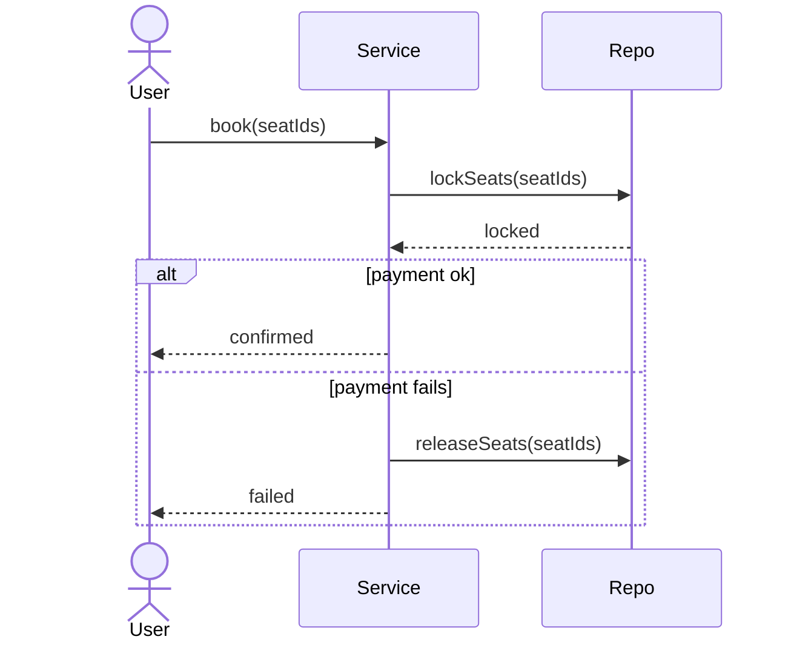

# Day 26 — Sequence + Activity Diagrams (Light)

> These are communication aids, not deeply-tested skills. Learn enough to sketch one
> when asked "walk me through the flow." Don't over-invest.

## Cheat Sheet

- **Sequence diagram** = objects talking over time. Top→bottom = time.
- **Solid arrow → = call. Dashed arrow ⇠ = return.** That's 90% of it.
- `alt/else` = branch, `loop` = repeat, `opt` = optional. Only if useful.
- **Activity diagram** (Day 24) = workflow: decision ◇ = choose ONE; fork/join ▬ = parallel.
- **The real skill is narration**: if you can *say* "A calls B, which does C then D," the drawing is just a prop.

## When to use which diagram

| Diagram | Answers | Mermaid keyword |
|---------|---------|-----------------|
| Class | types + relationships | `classDiagram` |
| Sequence | who calls whom, in order | `sequenceDiagram` |
| Activity | steps + branches + parallelism | `flowchart` / `stateDiagram-v2` fork |
| State | one entity's lifecycle | `stateDiagram-v2` |

## Critical Example — Sequence (Mermaid)

- `->>` call · `-->>` return · `alt/else/end` branch.

## Interview Questions & Answers

**Q: "Walk me through what happens when a user books a ticket."**
A: "UI calls BookingService.book(). It locks the seats via SeatRepo, charges via PaymentGateway. On success it confirms the seats and returns a booking; on failure it releases the locked seats and returns an error." (That narration IS the sequence diagram.)

**Q: "Sequence vs activity diagram?"**
A: "Sequence shows ordered messages between specific objects — who calls whom. Activity shows a workflow's steps, branches, and parallel paths. Sequence = collaboration; activity = control flow."

**Q: "When would you draw a sequence diagram in an interview?"**
A: "When asked to walk through a flow, or to show a tricky interaction like a payment-with-rollback. Otherwise I'd just narrate it — the diagram is a communication aid, not required."

## Clues & Signals

- **Senior signal**: narrating a flow cleanly without needing to draw it.
- **Senior signal**: using `alt` to show the failure/rollback path (not just the happy path).
- **Red flag**: obsessing over diagram syntax instead of the design.
- **Reality**: not deeply tested — don't over-invest.

## Quick Links

- **Detailed topic**: [Sequence Diagrams](../topics/uml/sequence-diagrams.md)
- **Related**: [Activity Diagrams](../topics/uml/activity-diagrams.md)
- **Related**: [Class Diagram Notation](../topics/uml/class-diagram-notation.md)
- **Next**: State Diagrams (Day 27)
