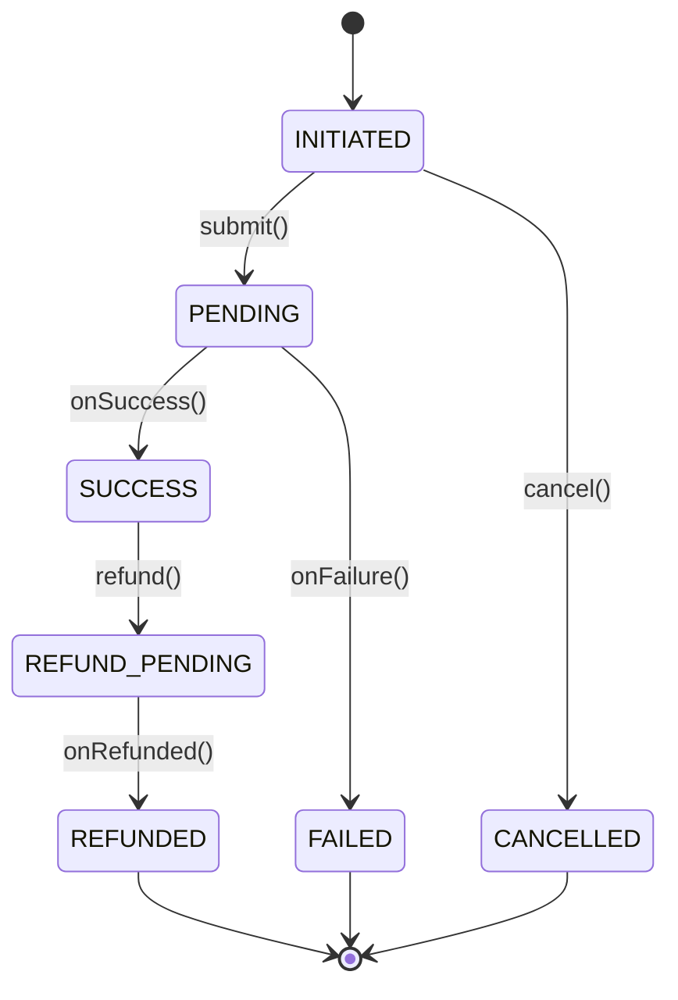

# Day 27 — State Diagrams

## Cheat Sheet

- **State diagram** = lifecycle of ONE entity: states + transitions + guards + forbidden moves.
- Transition label: **`event [guard] / action`**.
- **The tested part is INVALID transitions** — name what's forbidden and why.
- **Terminal states** have no exits (REFUNDED, CANCELLED, FAILED). Retry = a NEW entity, not a revival.
- **The guard IS the diagram in code**: `if (status != SUCCESS) throw`.
- Entity **rejects** illegal transitions — never silently allows.
- Diagram = State pattern = enum+guards: three views of one truth. Pick by complexity (Day 21).

## Critical Example — Payment lifecycle (Mermaid)



```java
void refund() {
    if (status != PaymentStatus.SUCCESS)
        throw new IllegalStateException("refund only a SUCCESS, was " + status);
    status = PaymentStatus.REFUND_PENDING;
}
```

## Forbidden Transitions (the senior part)

| Attempted | Allowed? | Why |
|-----------|----------|-----|
| FAILED → SUCCESS | ❌ | retry = new payment |
| SUCCESS → PENDING | ❌ | no backwards |
| INITIATED → REFUNDED | ❌ | never charged |
| CANCELLED/REFUNDED → * | ❌ | terminal |

## Representation choice (Day 21 restraint)

| Transitions | Use |
|-------------|-----|
| Simple, little per-state behaviour | enum + guard clauses |
| Rich per-state behaviour, sprawling if(status) | State pattern (class per state) |

## Interview Questions & Answers

**Q: "Draw the payment state machine."**
A: "INITIATED → PENDING on submit → SUCCESS or FAILED. SUCCESS can go to REFUND_PENDING → REFUNDED. INITIATED can be CANCELLED. FAILED, CANCELLED, REFUNDED are terminal."

**Q: "Can you refund a failed payment?"**
A: "No. Refund is only valid from SUCCESS — the guard rejects it otherwise. A failed payment that the user retries becomes a brand-new payment entity, not a transition out of FAILED."

**Q: "How do you prevent invalid transitions in code?"**
A: "Each transition method guards on the current state and throws if it's illegal — `if (status != SUCCESS) throw`. Status is only mutated through these guarded methods, never assigned directly."

**Q: "Enum or the State pattern?"**
A: "Enum + guard clauses when transitions are simple. The full State pattern — one class per state — only when each state has substantial behaviour and status-checks are sprawling across methods. Otherwise the pattern is over-engineering."

**Q: "What's a terminal state?"**
A: "A state with no outgoing transitions — the entity's lifecycle is complete. REFUNDED and CANCELLED here. Attempts to transition out are rejected."

## Clues & Signals

- **Senior signal**: naming forbidden transitions, not just the happy path.
- **Senior signal**: "a retry is a new entity, not a FAILED→PENDING transition."
- **Senior signal**: guarded transition methods; status never set directly.
- **Senior signal**: enum+guards over State pattern when simple.
- **Red flag**: happy-path-only; backwards/terminal transitions allowed; direct status assignment.

## Quick Links

- **Detailed topic**: [State Diagrams](../topics/uml/state-diagrams.md)
- **Related**: [State Pattern](../topics/design-patterns/behavioural/state.md)
- **Next**: Full OOAD Exercise (Day 28)
