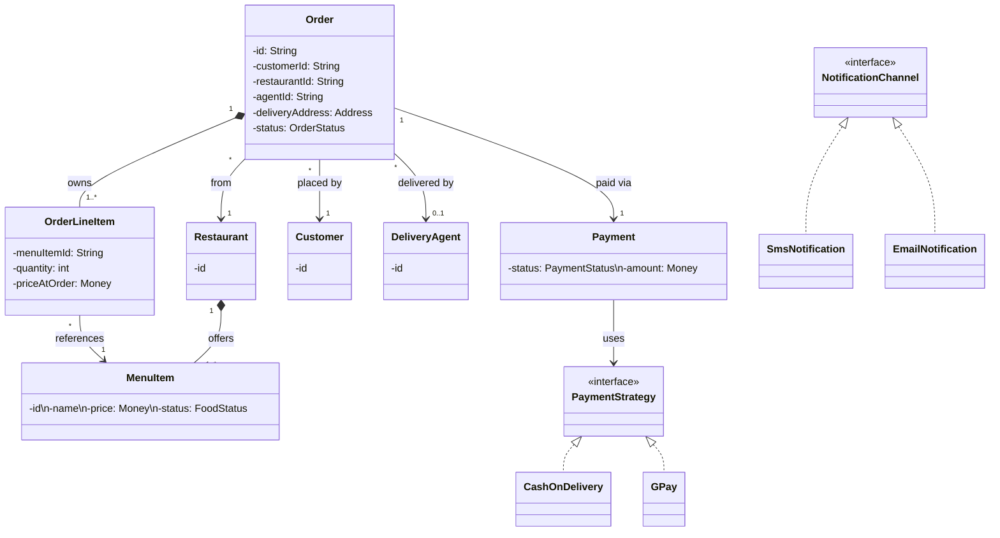
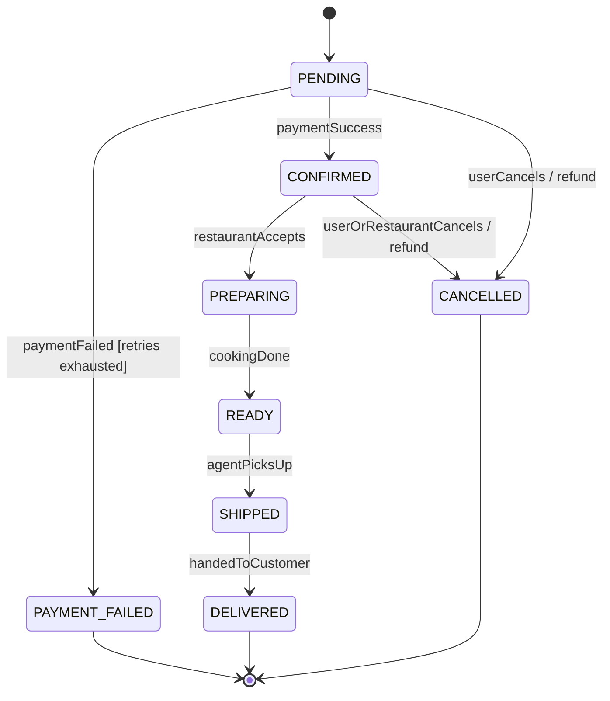

# Day 28 Capstone — Food Delivery OOAD (Reference)

Open preview (Cmd+Shift+V) for diagrams.

---

## 1. Scope
In: browse menu, cart, place order, pay, prepare→pickup→deliver, cancel (within rules), refund, notify.
Out: vendor onboarding, agent-matching algorithm, agent fees, batching, offers.
Fork Qs: cancellation window? refund policy? COD vs prepaid?

## 2. Actors (distinct from entities)
Customer, Delivery Agent, Restaurant/Vendor, (Payment Gateway = external actor).

## 3. Entities / VOs / enums
| Thing | Type | Note |
|-------|------|------|
| Customer | Entity | |
| Restaurant | Entity (aggregate root of its menu) | |
| MenuItem / FoodItem | Entity | catalog entry owned by Restaurant |
| **OrderLineItem** | Entity (internal to Order) | qty + **price-at-order-time** snapshot |
| Order | Entity, aggregate root | |
| DeliveryAgent | Entity (separate aggregate) | |
| Payment | Entity | own lifecycle |
| Money, Address | Value Objects | immutable; Money=BigDecimal+Currency |
| OrderStatus, PaymentStatus, FoodStatus | enums | |
| PaymentStrategy | interface (Strategy) | COD / GPay / Paytm |
| NotificationChannel | interface | SMS / Email |

KEY: MenuItem (catalog, shared, long-lived) ≠ OrderLineItem (owned by order, snapshots qty+price).
Same trap as Book vs BookCopy. A transaction referencing a catalog item needs a line-item in between.

## 4. Aggregates
- **Order** (root) ◆ owns OrderLineItems. References Customer/Agent/Restaurant by ID.
- **Restaurant** (root) ◆ owns MenuItems.
- **DeliveryAgent** (root) — separate.
- **Payment** — small aggregate, own status lifecycle.
- Top-level orchestrators: OrderService, PaymentService, RefundService, NotificationService.

## 5. Class Diagram

## 6. Sequence (place order → pay), with failure
Customer builds cart → chooses payment → places order.
OrderService validates (items available? address valid?) → creates Order (PENDING) →
PaymentService.charge(strategy). On success → Order stays PENDING/CONFIRMED, notify restaurant+agent.
On failure → retry once → still fail → Order = PAYMENT_FAILED (terminal). No order confirmed.
Cancel: OrderService validates (reject if already PREPARING+) → CANCELLED + RefundService.refund →
Payment = REFUND_INITIATED → REFUNDED.

## 7. State Machine

Forbidden: PREPARING/READY/SHIPPED/DELIVERED → CANCELLED (food already in motion);
any backwards transition. Distinguish cancel CAUSE (user vs restaurant) via a reason field.

## 8. What-if
- **New payment method / channel** → new Strategy / Channel class, zero changes (OCP).
- **Concurrency race**: user cancels the instant restaurant hits "preparing" → guard on status
  + make transitions atomic/idempotent; whoever acquires the state transition first wins,
  the loser's guard rejects.
- **Paid but restaurant rejects** → compensation: Order→CANCELLED, Payment→REFUND_INITIATED (saga, Day 68).

## Senior insight to keep
**Separate PaymentStatus from OrderStatus** — two independent lifecycles. Payment can be PAID
while Order is PREPARING; they change for different reasons. One shared enum couples them wrongly.
