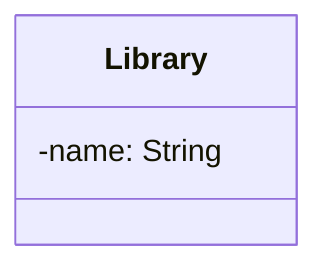

# Day 25 Practice — Library Management System (YOUR turn)

> Open Markdown preview (Cmd+Shift+V) to render. Fill in the class boxes and the
> relationships yourself. No hints on which patterns (if any) to use.

---

## The Prompt (cold — no hints)

Design a **Library Management System**. From the description, produce a complete
class diagram: classes, Entity/VO/enum classification, relationships with
multiplicity, any interfaces (only if justified), and the aggregate root(s).

Requirements:
- A **Library** has many **Book** titles. Each title can have multiple physical
  **BookCopy** items (e.g. 5 copies of the same book).
- A **Member** can borrow multiple copies at once. Each borrowed copy is tracked
  by a **Loan** (which copy, which member, borrow date, due date, return date).
- When a copy is returned late, a **Fine** is calculated. Fine rules may change
  (flat per day now; the business wants tiered/capped rules later).
- A book copy is either AVAILABLE, BORROWED, or LOST.
- Members have a type: STANDARD (max 3 loans) or PREMIUM (max 10 loans).
- The system records **Payment** when a member pays a fine.

Decide for each thing: Entity, Value Object, or enum. Decide each relationship:
association / aggregation / composition, with multiplicity. Decide where (if
anywhere) an interface/Strategy is justified — and where it would be
over-engineering. Identify the aggregate root(s).

---

## Mermaid Cheat Sheet

| Relationship | Mermaid | | Multiplicity: `A "1" *-- "*" B` |
|---|---|---|---|
| Association | `A --> B` | Composition ◆ | `A *-- B` |
| Aggregation ◇ | `A o-- B` | Realization (implements) | `A <|.. B` |

enum: `class X { <<enumeration>> VAL1 \n VAL2 }` · interface: `class X { <<interface>> }`

---

## Your Class Diagram (fill in)



---

## Your Reasoning (write WHY for each decision)

Classification:
- Library:
- Book:
- BookCopy:
- Member:
- Loan:
- Fine:
- Payment:
- CopyStatus / MemberType:
- Money:

Relationships (type + multiplicity + why):
- Library → Book:
- Book → BookCopy:
- Member → Loan:
- Loan → BookCopy:
- Loan → Fine:
- Fine → Payment:

Interface / Strategy decision (where justified, where over-engineering):
-

Aggregate root(s):
-
```
