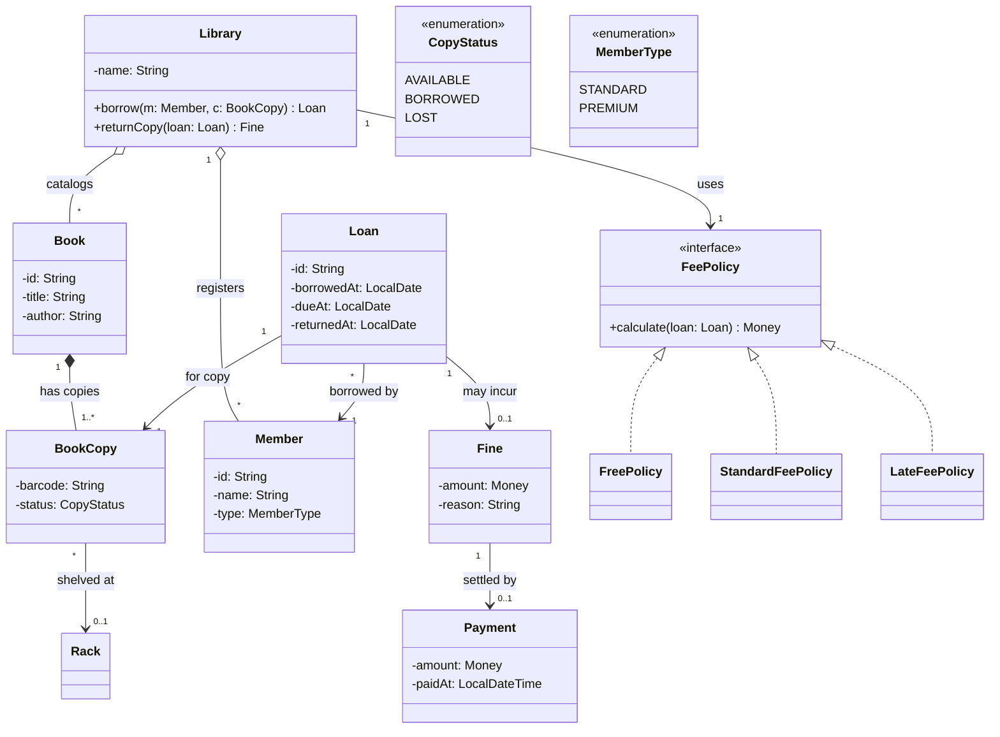

# Day 25 — Library Management System (Reference Solution)

Open Markdown preview (Cmd+Shift+V) to render.

---

## Classification

| Thing | Type | Why |
|-------|------|-----|
| Library | Entity (top aggregate root) | owns the lending operations, guards cross-entity invariants |
| Book | Entity (root of Book+BookCopy) | the title/catalog record |
| BookCopy | Entity | a physical item with its own identity, status, location |
| Member | Entity | a person, tracked over time |
| Loan | Entity (root of Loan+Fine+Payment) | the lending transaction |
| Fine | Entity (or VO) | computed penalty for a late loan |
| Payment | Entity | records settlement of a fine |
| Rack | Value Object | a shelf location label (Entity if racks are managed/tracked) |
| Money | Value Object | immutable, integer minor units |
| CopyStatus | enum | AVAILABLE / BORROWED / LOST — fixed set |
| MemberType | enum | STANDARD(max 3) / PREMIUM(max 10) — fixed set, NOT a hierarchy |
| FeePolicy | **interface (Strategy)** | fee varies: free / standard / late — open-ended, swappable |

Key calls:
- Book vs BookCopy: title vs physical item (identity). A copy is borrowed/lost individually → entity, not a counter.
- MemberType: enum, not a subclass hierarchy (fixed set, Day 21 restraint).
- FeePolicy: the ONE justified pattern — fee rules vary and will grow.

---

## Aggregate Roots (THREE, not one)

- **Library** — top root. `borrow()` / `returnCopy()` guard invariants spanning Member + BookCopy + Loan
  (member under loan limit AND copy AVAILABLE). No single entity can enforce that alone.
- **Book** — root of {Book, BookCopy}. Copies owned by composition.
- **Loan** — small root of {Loan, Fine, Payment}. The lending transaction.

Lesson: the entity the action *flows through* (Loan) is not automatically the root.
The root *owns a cluster and guards its invariants*. Loan only references Member/Copy, so it
cannot be their root.

---

## Class Diagram

Note: one Loan = one BookCopy (prompt says "each borrowed copy is tracked by a Loan").
A member has many Loans. This keeps per-copy due dates / fines clean, vs one Loan holding
a basket of copies (which muddles per-item return and late fees).

---

## Where patterns were and were NOT used

| Candidate | Decision | Why |
|-----------|----------|-----|
| FeePolicy (free/standard/late) | ✅ Strategy | varies, open-ended, swappable at runtime |
| MemberType limits | ❌ enum | fixed set; limit is a property keyed off the enum |
| Rack | VO (or Entity) | a location label; promote only if racks are managed |
| borrow/return orchestration | Library method / LendingService | spans multiple aggregates → root/service, not Loan |
