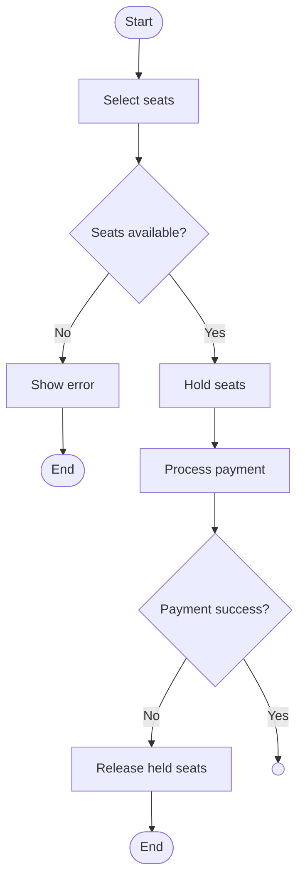

# Day 24 Practice — Movie Booking (YOUR turn)

> Open the Markdown preview (Cmd+Shift+V) to see these render.
> Fill in the `TODO` arrows + multiplicity yourself. The scaffolds below use
> placeholder arrows just so they render — **change them to match your analysis.**

---

## Mermaid Arrow Cheat Sheet (keep this handy)

| Relationship | Mermaid | Renders |
|--------------|---------|---------|
| Association | `A --> B` | plain arrow |
| Aggregation ◇ (shared) | `A o-- B` | empty diamond on A |
| Composition ◆ (owns) | `A *-- B` | filled diamond on A |
| Generalization (extends) | `A <|-- B` | solid + hollow triangle |
| Realization (implements) | `A <|.. B` | dashed + hollow triangle |
| Multiplicity | `A "1" --> "*" B` | numbers on ends |

Rule: **diamond sits on the OWNER**; **triangle points to the PARENT/interface**.

---

## PART A — Class Diagram (fill in the relationships)

Prompt:
- MovieShow happens in exactly one Screen; a Screen hosts many shows.
- MovieShow has many Seat entries; a seat is meaningless without its show.
- Booking made by one Customer; a customer makes many bookings.
- Booking reserves one or more Seat entries.
- Payment is an interface; CardPayment & WalletPayment implement it. Booking has exactly one Payment.

```mermaid
classDiagram
    class MovieShow {
        -showId: String
        -startTime: LocalDateTime
    }
    class Screen {
        -screenId: String
    }
    class Seat {
        -seatNumber: String
    }
    class Booking {
        -bookingId: String
    }
    class Customer {
        -customerId: String
    }
    class Payment {
        <<interface>>
        +pay(amount) void
    }
    class CardPayment
    class WalletPayment

    %% TODO: pick the right arrow + multiplicity for each line below.
    %% (placeholders are just so it renders — decide symbol + numbers yourself)

    MovieShow "*"-->"1" Screen : runs in
    MovieShow 1◆-->* Seat : has
    Booking   *-->1 Customer : made by
    Booking   1◇-->1..* Seat : reserves
    Booking   "1" --> "1" Payment : uses
    %% Payment <|.. CardPayment 1 
    %% Payment <|.. WalletPayment 1
```

---

## PART B — Activity Diagram (fill in the flow)

Prompt:
select seats → check availability → if any taken, error+stop → if available,
hold seats + process payment → if payment fails, release seats+stop → if success,
then CONCURRENTLY confirm booking + email + SMS → after all three, show ticket.

Fork/join trick in Mermaid flowcharts: use a single node as the fork point,
branch out to the 3 parallel steps, then converge them into a single join node.



---

## Your notes / reasoning (write why you chose each)

- MovieShow → Screen:
- MovieShow → Seat:
- Booking → Customer:
- Booking → Seat:
- Booking → Payment:
- Payment ← Card/Wallet:
