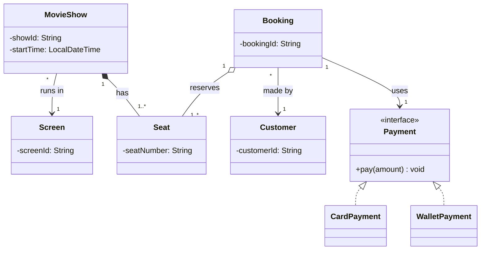
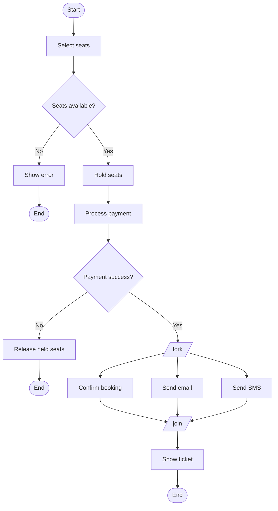
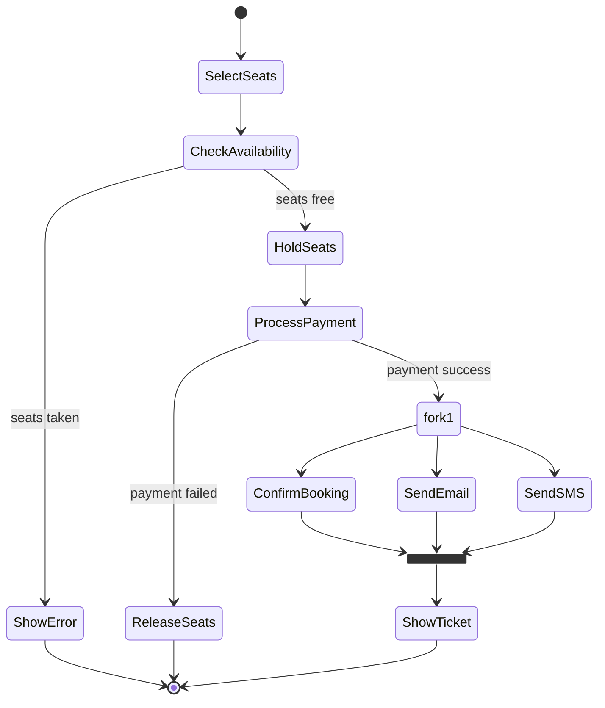

# Day 24 — Movie Booking (Reference Solution)

Validated class + activity diagrams. Open Markdown preview (Cmd+Shift+V) to render.

---

## Part A — Class Diagram

Relationship decisions:

| Relationship | Type | Multiplicity | Why |
|--------------|------|--------------|-----|
| MovieShow → Screen | association `-->` | `*` show / `1` screen | show references its screen; screen is independent, hosts many shows |
| MovieShow → Seat | **composition** `*--` | `1` show / `1..*` seats | a seat entry is meaningless without its show; owned + dies with it |
| Booking → Customer | association `-->` | `*` bookings / `1` customer | customer is a referenced peer aggregate |
| Booking → Seat | **aggregation** `o--` | `1` booking / `1..*` seats | booking *reserves* seats it does NOT own — seats belong to the show |
| Booking → Payment | association `-->` | `1` / `1` | booking uses one payment |
| Card/Wallet → Payment | **realization** `<\|..` | — | implements the interface (dashed triangle) |

Key insight: the same **Seat** is *composed by* MovieShow (owner) but only *aggregated by* Booking
(reserved, not owned). A child can be composed by exactly one parent; other references are aggregation/association.

Mermaid reminders:
- Composition = `*--`, Aggregation = `o--` (letters — Mermaid draws the diamond).
- Multiplicity in quotes, outside the arrow: `A "1" *-- "*" B`.
- Realization (implements) = `<|..` (dashed); Generalization (extends) = `<|--` (solid).

---

## Part B — Activity Diagram (flowchart form)

## Part B — same flow with REAL UML fork/join bars (stateDiagram-v2)

Decision (`{...}` / labeled transitions) = choose ONE path (OR).
Fork/Join (`<<fork>>`/`<<join>>`) = run ALL paths in parallel (AND), join waits for all.
