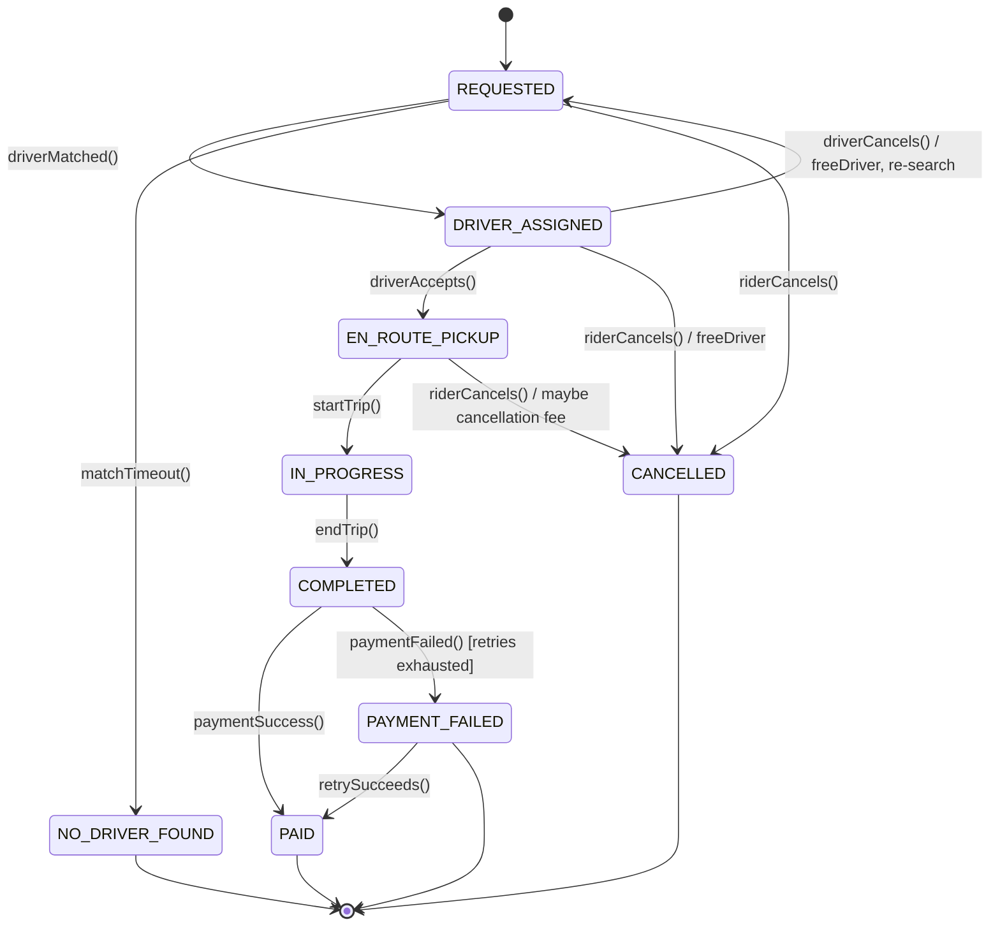

# Day 27 — Ride Lifecycle State Machine (Reference)

Open Markdown preview (Cmd+Shift+V) to render.

---

## State Diagram



Notes:
- Cancellation allowed only BEFORE the trip starts (REQUESTED, DRIVER_ASSIGNED,
  EN_ROUTE_PICKUP). Once IN_PROGRESS, you cannot cancel — the trip is physically happening.
- Driver cancel ≠ rider cancel: driver cancel loops back to REQUESTED (re-match);
  rider cancel is terminal CANCELLED. Both free the assigned driver.
- Payment: once the trip is COMPLETED, a payment failure cannot un-drive the ride.
  After retries, it becomes PAYMENT_FAILED (an outstanding-balance/dispute), NOT a cancellation.

---

## Forbidden Transitions

| Attempted | Why forbidden |
|-----------|---------------|
| IN_PROGRESS / COMPLETED / PAID → CANCELLED | trip already happening/done — can't un-ride |
| DRIVER_ASSIGNED / IN_PROGRESS → REQUESTED (except driver-cancel) | no arbitrary backwards moves |
| REQUESTED → PAID / COMPLETED | can't skip the actual ride |
| NO_DRIVER_FOUND / CANCELLED / PAID → anything | terminal states |
| PAYMENT_FAILED → CANCELLED | the ride happened; it's a debt, not a cancellation |

---

## Terminal states (and WHY distinguish them)

| Terminal | Cause | Downstream difference |
|----------|-------|-----------------------|
| PAID | happy completion | revenue recorded |
| CANCELLED (by=RIDER) | rider aborted | maybe cancellation fee; counts vs rider |
| CANCELLED (by=DRIVER before accept) | driver bailed | counts vs driver rating/supply |
| NO_DRIVER_FOUND | system couldn't match | no charge; counts vs supply shortage |
| PAYMENT_FAILED | trip done, payment unresolved | outstanding balance / dispute flow |

All are "ended," but billing, metrics, and behaviour differ — so capture the CAUSE
(e.g. CANCELLED with a `cancelledBy` / `reason` field), don't collapse them into one blob.

---

## Enum vs State pattern (the restraint call)

- ~9 states, but each state's logic is THIN (validate transition + a small side effect
  like freeing the driver).
- Number of states is NOT the trigger for the State pattern — richness of per-state
  BEHAVIOUR is.
- **Decision: enum + a transition table / guard clauses.** Refactor to full State pattern
  only if states gain substantial, diverging behaviour (per-state pricing, timeouts,
  cancellation rules).

```java
enum RideStatus { REQUESTED, DRIVER_ASSIGNED, EN_ROUTE_PICKUP, IN_PROGRESS,
                  COMPLETED, PAID, CANCELLED, NO_DRIVER_FOUND, PAYMENT_FAILED }

class Ride {
    private RideStatus status;

    void cancelByRider() {
        if (status != RideStatus.REQUESTED && status != RideStatus.DRIVER_ASSIGNED
                && status != RideStatus.EN_ROUTE_PICKUP)
            throw new IllegalStateException("cannot cancel after trip starts: " + status);
        freeDriverIfAssigned();
        status = RideStatus.CANCELLED;
    }
}
```
