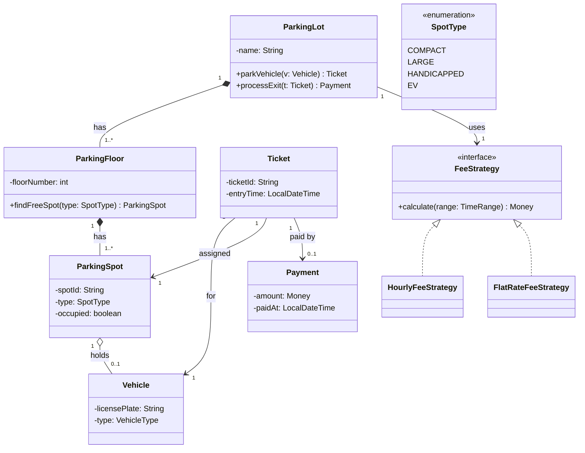

# Drawing a Full Class Diagram (Parking Lot Walkthrough)

## Definition

A repeatable procedure for turning any LLD prompt into a complete, interview-grade
class diagram. The vehicle here is Parking Lot — the most common warm-up — but the
**procedure** is the transferable skill, not the specific answer.

---

## The 8-Step Procedure

```
1. Clarify requirements & scope       — what's in, what's out
2. Nouns  → candidate classes         — entities & value objects
3. Verbs  → responsibilities/methods  — behaviour + hidden entities
4. Classify each: Entity or VO        — identity vs value (Day 22)
5. Relationships + multiplicity       — own vs reference (Day 23/24)
6. Interfaces where variation is real — Strategy/Factory, only if justified (Day 21)
7. Identify aggregate root(s)         — the entry points (Day 23)
8. Read it back aloud                 — verify against requirements
```

Order matters: **nouns before relationships, relationships before patterns.**
Juniors jump to patterns at step 1; seniors earn them at step 6.

---

## WHY It Matters

| Benefit | Explanation |
|---------|-------------|
| Structure under pressure | A procedure beats staring at a blank whiteboard. |
| Scoping signal | Step 1 (clarify) is a top senior marker. |
| Avoids over-engineering | Patterns come at step 6, only where variation is real. |
| Covers the whole toolkit | Entities/VOs, aggregates, relationships, multiplicity, restraint — all in one artifact. |

---

## Step 1 — Clarify Scope (never skip)

State assumptions before drawing:

> "Assume: multiple floors; spot types compact/large/handicapped/EV; vehicles of
> different sizes; ticket on entry; fee by duration; payment on exit. Out of scope
> for v1: reservations, multiple entrances, real payment gateway. OK?"

Scoping out loud shows you bound the problem before building — a strong signal.

---

## Steps 2–4 — Nouns → Classes → Classify

| Noun | Entity / VO / Enum | Why |
|------|--------------------|-----|
| ParkingLot | Entity (aggregate root) | the system; single entry point |
| ParkingFloor | Entity | tracked; owns spots |
| ParkingSpot | Entity | each spot is a distinct, tracked thing |
| Vehicle | Entity | identified by license plate |
| Ticket | Entity | unique ID, tracks the parking session |
| Payment | Entity | a specific transaction |
| SpotType / VehicleType | **enum** | fixed closed set — NOT a class hierarchy (Day 21) |
| Money / Fee | **Value Object** | defined by value, immutable (Day 22) |
| TimeRange (entry→exit) | **Value Object** | immutable duration |

Key restraint: not everything is an entity. Enums for fixed sets, VOs for value-defined things.

---

## Step 5 — Relationships + Multiplicity

Apply the "own vs reference" test:

```
ParkingLot   ◆── "1..*" ── ParkingFloor     composition  (floors are part of the lot)
ParkingFloor ◆── "1..*" ── ParkingSpot       composition  (spots belong to the floor)
ParkingSpot  o── "0..1" ── Vehicle            aggregation  (holds a vehicle; it drives away)
Ticket       ──  "1"   ─▶  Vehicle            association  (references the vehicle)
Ticket       ──  "1"   ─▶  ParkingSpot          association  (references the assigned spot)
Ticket       ──  "1"   ─▶  Payment              association  (one payment per ticket)
ParkingLot   ──  "1"   ─▶  FeeStrategy          association  (uses a pricing policy)
```

Judgment calls:
- **Lot → Floor → Spot = composition** — a spot has no meaning outside its floor.
- **Spot → Vehicle = aggregation** `0..1` — the spot temporarily holds a vehicle that exists on its own.
- **Ticket → others = association** — the ticket references, doesn't own.

---

## Step 6 — Interfaces Only Where Variation Is Real

**Fee calculation varies** (hourly / flat / weekend surge), is open-ended, swappable →
**Strategy earns its place:**

```
«interface» FeeStrategy   +calculate(TimeRange): Money
        ▲                         ▲
   HourlyFeeStrategy        FlatRateFeeStrategy
```

**Spot assignment** — add a Strategy ONLY if the algorithm genuinely varies
(nearest, random, load-balanced). If v1 just takes the first free spot of the right
size, keep it a plain method and say so:

> "I'll keep assignment as a simple method; if we need pluggable algorithms I'd
> extract an `AssignmentStrategy`." (Day 21 restraint.)

---

## Step 7 — Aggregate Roots

- **ParkingLot** = top root. Entry point for park/exit operations.
- **Ticket** = a small aggregate (the session: vehicle + spot + times + payment).

The root owns the operation:
`Ticket t = parkingLot.parkVehicle(vehicle)` — internally finds a floor, assigns a
spot, issues the ticket. The caller never manipulates spots directly.

---

## Step 8 — Read It Back

"ParkingLot owns 1..* Floors; each Floor owns 1..* Spots; a Spot holds 0..1 Vehicle;
a Ticket references the vehicle, its spot, and one payment; the Lot uses a FeeStrategy."
If that matches the requirements, the diagram is sound.

---

## Full Diagram (Mermaid)



---

## Common Mistakes

| Mistake | Fix |
|---------|-----|
| Everything is an entity | Enums for fixed sets, VOs for value-defined things |
| `SpotType` as a class hierarchy | It's a fixed closed set → enum |
| Strategy for assignment with one impl | Keep a plain method until a 2nd algorithm appears |
| No aggregate root; caller pokes at spots | Route through `ParkingLot.parkVehicle()` |
| Missing multiplicity | Annotate every association end |
| Spot → Vehicle as composition | It's aggregation — vehicle exists independently |

---

## Resources

- [LLD Problem-Solving Framework](../lld-approach/problem-solving-framework.md)
- [Class Diagram Notation](class-diagram-notation.md)
- [Aggregates](../domain-modeling/aggregates.md)
- [Entity vs Value Object](../domain-modeling/entity-vs-value-object.md)
- [Pattern Selection](../design-patterns/pattern-selection.md)

## Related

- [UML index](README.md)
