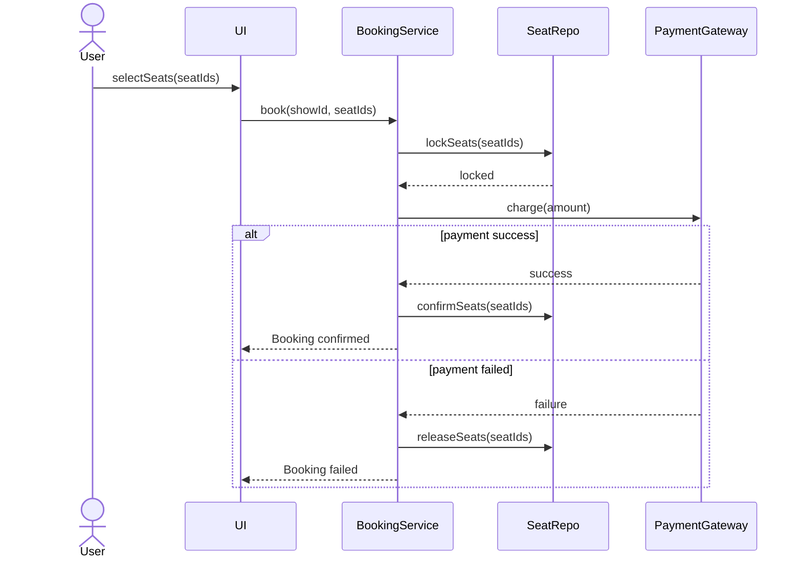

# UML Sequence Diagrams (Light)

> Reality check: sequence diagrams are a **communication aid**, not a deeply-tested
> interview skill. You'll use them to answer "walk me through the flow." Learn just
> enough to sketch one confidently. No one grades your `alt` block syntax.

## Definition

A sequence diagram shows **objects interacting over time** — who calls whom, in what
order. Time flows **top → bottom**. Answers *"what happens when a user does X?"*

## The 5 things that matter

| Element | Meaning |
|---------|---------|
| Box at top | a participant (actor / object) |
| Vertical dashed line | its lifeline (down = time) |
| **Solid arrow →** | synchronous method call |
| **Dashed arrow ⇠** | return value |
| Activation bar | thin rectangle = object is busy |

Optional (only if useful):
- `alt [cond] / else` = branch (if/else)
- `loop [for each]` = repetition
- `opt [cond]` = optional step

## Mermaid syntax (renders in Kiro)

Syntax: `->>` call, `-->>` return, `alt/else/end` branch, `loop/end` repeat.

## Sequence vs Activity vs Class — when to use which

| Diagram | Answers | Use when |
|---------|---------|----------|
| Class | "what are the types + relationships?" | modeling structure (the main LLD artifact) |
| Sequence | "who calls whom, in what order?" | "walk me through the flow" |
| Activity | "what steps/branches/parallelism?" | a workflow with decisions + concurrency |
| State | "what states does ONE entity move through?" | lifecycle (Order: CREATED→PAID→...) |

## The one interview-useful idea

A sequence diagram forces you to **narrate the collaboration**: "UI calls BookingService,
which locks seats, charges payment, confirms on success, releases on failure." If you can
*say* that cleanly, the drawing is optional — it's just a prop for the narration.

## Resources

- [PlantUML sequence](https://plantuml.com/sequence-diagram)
- [Mermaid sequence](https://mermaid.js.org/syntax/sequenceDiagram.html)

## Related

- [Activity Diagrams](activity-diagrams.md)
- [Class Diagram Notation](class-diagram-notation.md)
- [UML index](README.md)
