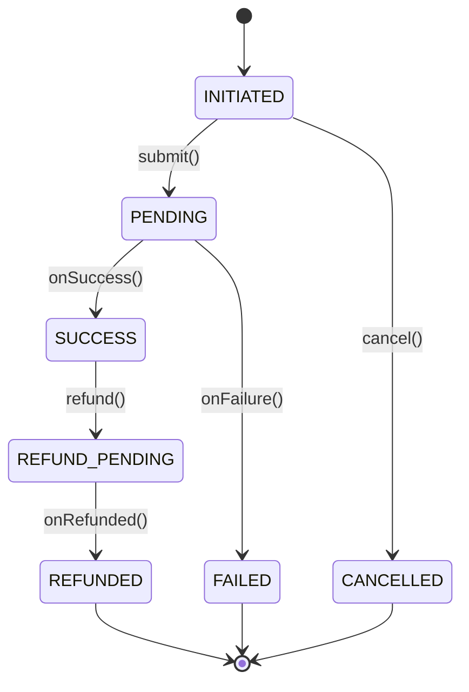

# UML State Diagrams

## Definition

A **state diagram** (state machine) models the **lifecycle of a single entity**: the
states it can be in, the transitions between them (triggered by events, filtered by
guards), and — critically — the transitions that are **forbidden**.

This is the diagram form of the [State pattern](../design-patterns/behavioural/state.md).
Diagram, pattern, and guarded code are three views of the same truth.

---

## WHY It Matters

| Benefit | Explanation |
|---------|-------------|
| Most LLD entities are stateful | Order, Payment, Elevator, Booking, ATM all have lifecycles. |
| Invalid transitions are the real design | "Can you cancel a shipped order?" is a direct interview probe. |
| Encodes invariants | The guard "refund only a SUCCESS" is the diagram, in code. |
| Prevents corruption | A modeled machine rejects illegal moves instead of silently allowing them. |

---

## Vocabulary

| Element | Symbol | Meaning |
|---------|--------|---------|
| Initial | ● filled circle | starting state |
| State | rounded box | a named condition (PENDING, PAID) |
| Transition | labeled arrow | state A → B on an event |
| Guard | `[condition]` | transition fires only if condition holds |
| Event | arrow label | trigger (`pay()`, `cancel()`) |
| Action | `/ action` | side effect on transition |
| Final | ⊙ circle-dot | terminal state (optional) |

Transition label format: **`event [guard] / action`**.

---

## Canonical Example — Payment Lifecycle



Read: payment starts INITIATED → PENDING on submit → SUCCESS or FAILED. Only a SUCCESS
can be refunded (→ REFUND_PENDING → REFUNDED).

---

## The Part That Gets Tested: Forbidden Transitions

A junior draws the happy arrows. A senior also states what's **not** allowed and why:

| Attempted | Allowed? | Why |
|-----------|----------|-----|
| FAILED → SUCCESS | ❌ | a failure can't become success; retry = a NEW payment |
| REFUNDED → SUCCESS | ❌ | terminal; money already returned |
| INITIATED → REFUNDED | ❌ | can't refund what was never charged |
| SUCCESS → PENDING | ❌ | no going backwards |
| CANCELLED → * | ❌ | terminal |

Principle: **the entity rejects invalid transitions; it never silently allows them.**

```java
void refund() {
    if (status != PaymentStatus.SUCCESS)          // the guard IS the diagram
        throw new IllegalStateException("can only refund SUCCESS, was: " + status);
    this.status = PaymentStatus.REFUND_PENDING;
}
```

---

## Terminal vs Non-Terminal

- **Terminal** states have no outgoing transitions: REFUNDED, CANCELLED, FAILED. The
  entity is done; a retry creates a NEW entity rather than reviving a terminal one.
- Mark them. "Can I leave FAILED?" is a common probe — answer: no.

---

## State Diagram ↔ State Pattern ↔ Code

| State diagram | State pattern | Plain code |
|---------------|---------------|------------|
| States = boxes | one class per state | enum field |
| Transitions = arrows | state methods set next | status reassignment |
| Invalid transition | state method throws | guard clause rejects |

**Choose the representation (Day 21 restraint):**
- Simple transitions, little per-state behaviour → **enum + guard clauses**.
- Rich per-state behaviour, sprawling `if (status==...)` across methods → **State pattern** (class per state).

---

## Common Mistakes

| Mistake | Fix |
|---------|-----|
| Only happy-path arrows | Enumerate and reject invalid transitions |
| No guards | Add `[condition]` where a transition is conditional |
| Backwards/terminal transitions allowed | Guard them; retries create new entities |
| Full State pattern for 3 simple states | Use an enum + guards |
| Status mutated directly (`p.status = X`) | Transition only via guarded methods |

---

## Resources

- [uml-diagrams.org — state machine](https://www.uml-diagrams.org/state-machine-diagrams.html)
- [Mermaid state diagrams](https://mermaid.js.org/syntax/stateDiagram.html)

## Related

- [State Pattern](../design-patterns/behavioural/state.md)
- [Class Diagram Notation](class-diagram-notation.md)
- [Entity vs Value Object](../domain-modeling/entity-vs-value-object.md)
- [UML index](README.md)
